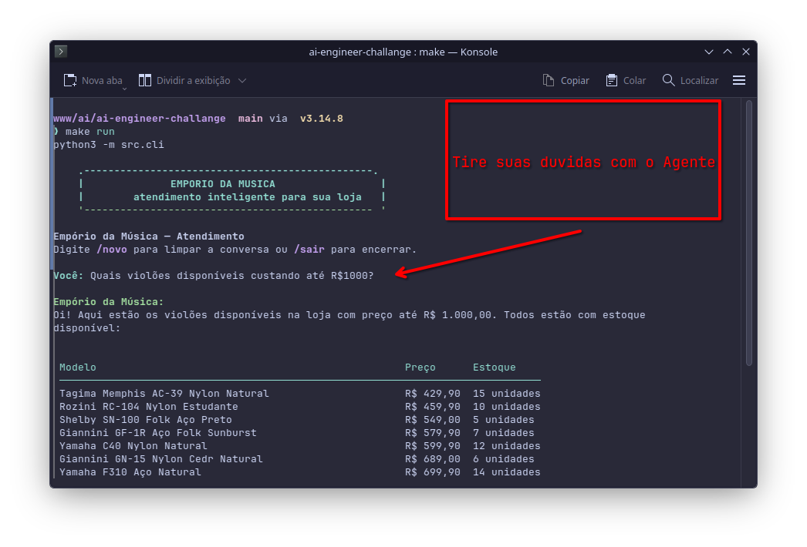

# Empório da Música — Customer Service Agent

Terminal-based customer service agent for **Empório da Música**, a fictional musical-instrument store in Campo Grande, Brazil. It answers questions about the catalog, prices, inventory, orders, promotions, payment, shipping, returns, and store policies.

The agent uses **function calling**: the model chooses which tool to query, while prices, deadlines, shipping, and business rules are calculated in code. The model does not invent data.

## What it does

- Searches products by name, category, specification, or price range.
- Reports availability, inventory, promotional prices, and active promotions.
- Looks up orders only after validating the account holder's email or phone.
- Calculates PIX, installments, and shipping.
- Queries the store policy manual.
- Politely refuses out-of-scope topics.
- Does not expose personal data or confirm whether an order exists to an unauthorized person.

## Architecture

```text
CLI (src/cli.py)
  │
  └── Agent (src/agent.py)
        ├── system prompt + policy manual
        ├── conversation history
        ├── function-calling loop
        └── tools (src/tools.py)
              ├── data_loader.py → CSVs
              └── policies.py    → Markdown manual
```

### Message flow

1. The customer types a message in the CLI.
2. The agent builds the context: persona, manual, history, and the new message.
3. The LLM either responds directly or requests one or more tools.
4. The dispatcher validates the tool and arguments, executes it, and returns the result to the model.
5. The cycle repeats until the model produces the final response, subject to `MAX_TOOL_ITERATIONS`.

There is no orchestration framework or vector database: the dataset is small enough to fit in memory, and the complete manual is injected into the prompt.

## Project structure

```text
.
├── data/
│   ├── products.csv
│   ├── categories.csv
│   ├── customers.csv
│   ├── orders.csv
│   ├── order_items.csv
│   ├── promotions.csv
│   ├── politicas_da_loja.pdf
│   └── politicas.md            # clean, versioned manual
├── examples/                   # 5 example conversations
├── src/
│   ├── agent.py                # loop, dispatcher, and tool schemas
│   ├── tools.py                # deterministic queries and calculations
│   ├── data_loader.py          # CSV loading and normalization
│   ├── policies.py             # manual extraction and queries
│   ├── prompts.py              # agent persona and rules
│   ├── history.py              # local JSON history
│   └── cli.py                  # terminal interface
├── tests/                      # data, policy, tool, and orchestration tests
├── assets/
│   ├── desafio - solução.md    # main problems and solutions
│   └── desafio_tecnico_ai_eng_artefact.pdf  # challenge reference
├── Makefile
├── requirements.txt
└── README.md
```

The CSVs were renamed to ASCII names without spaces. The loader still accepts the original names with the `desafio_tecnico_ai_eng - ` prefix as a fallback.

## Running the project

### Prerequisites

- Python 3.14.8 (recorded in [`.python-version`](./.python-version))
- An [OpenRouter](https://openrouter.ai/) API key
- Optional: `pdftotext` (Poppler) to regenerate the manual; without it, the project uses `pypdf`

### Step by step

**1. Clone the project and enter its directory**

```bash
git clone <REPOSITORY_URL>
cd atendimento-emporio-musica-desafio-artefact
```

**2. Create and activate a virtual environment**

```bash
python3.14 -m venv .venv
source .venv/bin/activate        # Windows: .venv\Scripts\activate
```

**3. Install dependencies**

```bash
make install
```

Or, without Make:

```bash
pip install -r requirements.txt
```

`requirements.txt` pins exact versions for reproducible installation. If you use `pyenv` or `uv`, the `.python-version` file may select the version automatically; otherwise, confirm that `python --version` returns `Python 3.14.8` after activating the environment.

**4. Configure environment variables**

```bash
cp .env.example .env
```

Edit `.env` and add your key:

```env
LLM_MODEL=nvidia/nemotron-3.5-super-vl:free
OPENROUTER_API_KEY=your-key-here
OPENROUTER_PROVIDER=nvidia
OPENROUTER_BASE_URL=https://openrouter.ai/api/v1
MAX_TOOL_ITERATIONS=5
REFERENCE_DATE=2026-02-18
```

| Variable | Required | Purpose |
|---|---|---|
| `OPENROUTER_API_KEY` | Yes | OpenRouter authentication |
| `LLM_MODEL` | No | Model used; it must support tool calling |
| `OPENROUTER_PROVIDER` | No | Pinned provider, without fallback |
| `MAX_TOOL_ITERATIONS` | No | Tool-loop limit |
| `REFERENCE_DATE` | No | Date used for return and exchange deadlines |

`REFERENCE_DATE=2026-02-18` is a demonstration date. In production, use the current date or remove the variable.

**5. Run the tests**

```bash
make test
```

Or:

```bash
pytest
```

**6. Start the agent**

```bash
make run
```

Or:

```bash
python -m src.cli
```

On startup, the CLI displays a fictional Empório da Música ASCII banner before opening the conversation.

Inside the CLI:

| Command | Action |
|---|---|
| `/novo` | Clears the current conversation |
| `/sair` | Ends the conversation |

### Other commands

| Command | Action |
|---|---|
| `make check` | Compiles `src/` and `tests/` and runs the suite |
| `make test-verbose` | Runs tests with details |
| `make policies` | Regenerates `data/politicas.md` from the PDF |
| `make clean` | Removes local caches |

## Tools

| Tool | Parameters | Purpose |
|---|---|---|
| `buscar_produtos` | `termo?`, `categoria?`, `preco_max?`, `incluir_indisponiveis?`, `limite?` | Catalog, effective price, inventory, promotion, and availability |
| `consultar_pedido` | `id_pedido`, `identificador_cliente` | Status, items, tracking, and deadlines after email or phone validation |
| `consultar_promocoes` | `produto?`, `limite?` | Active promotions only |
| `consultar_condicoes` | `valor`, `tem_promocao?`, `cidade?` | PIX, installments, and shipping |
| `consultar_politicas` | `topico` | Opening hours, payment, exchanges, returns, warranty, and more |

### Important behavior

- **Search:** ignores accents and case, handles singular/plural (`violões` → `violao`), and searches names, descriptions, categories, and specifications.
- **Availability:** `disponivel`, `sem_estoque`, `descontinuado`, or `em_breve`. Broad listings hide unavailable products; a search for a specific model shows it with a warning.
- **Promotions:** only `is_active=1`. Expired promotions are never offered.
- **Orders:** accepts email or phone only and compares digits. Names are not accepted. Missing orders and incorrect details return the same generic message.
- **Deadlines:** calculated from the estimated delivery date and `REFERENCE_DATE`.
- **Payment:** the 5% PIX discount does not apply to an already promotional price. Installments follow section 3.1 of the manual.
- **Shipping:** Campo Grande has a fixed price only. For other cities, the agent asks for the ZIP code and does not invent a price.

## Business rules and data

| Topic | Handling |
|---|---|
| Active product with zero inventory | `availability=sem_estoque`; hidden from broad listings |
| Discontinued or coming-soon product | Never treated as sellable |
| Promotions | Active only; original price, percentage, and promotional price are explicit |
| Order total | `orders.total_brl` is the official value and is not recalculated from item sums |
| Missing dates | `NaT`/`NaN` are converted to `null` in JSON |
| Duplicate email | Two customers share an email; the phone is required in that case |
| PDF manual | Extracted once, cleaned, and versioned in `data/politicas.md` |
| Store contact | `(67) 3341-4444` and `contato@emporiodamusica.com.br` |
| File names | ASCII CSV names, with fallback to the original names |

### Documented assumptions

- The return/exchange period uses `estimated_delivery` because the dataset has no actual receipt date.
- Orders are treated as online purchases for the right of withdrawal.
- Only Campo Grande is considered part of the metropolitan area for shipping rules.
- Section 3.1 takes precedence over the summary table in section 3 for installments.
- Free shipping in Campo Grande applies to purchases **above** R$ 500.
- Product 130 (`em_breve`) appears in orders: this data inconsistency is handled as not sellable in the catalog.

## Technical decisions

- **Python + standard-library modules:** the project is small and data-oriented. Separating `agent`, `tools`, `data_loader`, `policies`, and `history` keeps each responsibility testable without introducing an orchestration framework.
- **Function calling instead of RAG:** the data is tabular and answers require precision. Deterministic queries avoid similarity errors and support numeric filters.
- **Complete manual in the system prompt:** the document is about 3,000 tokens and fits in context. The `consultar_politicas` tool supports targeted queries and keeps the model grounded.
- **Deterministic retrieval:** CSVs are loaded into memory with `pandas`, and the manual is normalized into Markdown. Text search handles accents, singular/plural, relevant fields, and numeric filters; there is no vector database because the volume and domain do not justify its complexity.
- **Layered prompt:** the system prompt defines persona and scope, `POLICY_OVERRIDES` reinforces critical rules, and the manual provides the complete policy content. The final response is produced only after the required tool queries.
- **Calculations in code:** PIX, installments, shipping, and deadlines are arithmetic and business rules; small models often get long calculations wrong.
- **Configurable LLM and provider:** the integration uses the OpenRouter-compatible API, with model, provider, and iteration limit defined in `.env`. The provider is pinned without fallback for reproducibility; reasoning is enabled when supported by the model.
- **Pydantic validation + whitelist:** unknown tools and invalid arguments are returned to the model as errors without crashing the conversation.
- **CLI with `rich`:** Markdown responses are rendered in the terminal, including tables and lists.

## Tests

The suite uses local data and a fake client; no test calls the real provider.

```bash
make check
```

Main coverage includes:

- CSV integrity, without duplicates or orphan keys;
- availability derived from status and inventory;
- JSON without `NaT`/`nan`;
- manual sections, subsections, aliases, and fallback;
- search with accents, plurals, categories, specifications, and model codes;
- active promotions and effective prices;
- ownership by email/phone, duplicate email, and generic messages;
- order items and 7/30/90-day deadlines;
- PIX, installments, and shipping;
- agent orchestration: tool execution, invalid arguments, provider failure, and iteration limit.

## Interaction examples

Complete conversations are available in [`examples/`](./examples):

| File | Scenario |
|---|---|
| `01_catalogo.md` | Available guitars up to R$ 1,000 |
| `02_info_loja.md` | Store address and opening hours |
| `03_preco_promocao.md` | Price, promotion, and PIX/installment calculation |
| `04_devolucao.md` | Order, policy, and withdrawal deadline |
| `05_fora_escopo.md` | Accessory refusal and redirection |

## Known limitations

- Search is textual, not semantic; vague questions depend on product descriptions and specifications.
- There is no real authentication; order lookup validates an identifier provided in the conversation. Production would require OTP, login, or verified WhatsApp.
- History is local JSON without concurrency support.
- Free models may vary in quality and availability.
- Free models may hit the provider's daily limits; the CLI reports this and recommends waiting for renewal or configuring another model.
- The legal period uses the estimated delivery date, not the actual receipt date.
- For cities outside Campo Grande, shipping depends on the ZIP code and cannot be calculated from the available data.

### What I would do with more time

- Add observability with structured logs and latency, token, and provider-error metrics, without recording personal data.
- Create contract tests with at least one real model and evaluations for accuracy, out-of-scope refusal, and correct tool usage.
- Replace JSON history with concurrent storage and session control, and add real authentication for order lookups.
- Evolve manual retrieval to hybrid search only when document volume justifies the added complexity.

## Additional documentation

- [`desafio - solução.md`](./assets/desafio%20-%20solução.md) — main project problems and solutions.
- [`desafio_tecnico_ai_eng_artefact.pdf`](./assets/desafio_tecnico_ai_eng_artefact.pdf) — original challenge statement, retained for reference.

## Use of coding assistants

I used two tools with complementary roles:

- **OpenCode with free models:** used to explore the proposal, discuss architecture alternatives, review the implementation, and iterate on prompts, tools, and tests. Free models supported reasoning and generation; they were not the source of truth for the data.
- **GitHub Copilot in VS Code:** used for incremental implementation, code navigation, test adjustments, error handling, and documentation.

My workflow was: first understand the dataset and policies; then request suggestions and implement small changes; next verify each behavior against the CSVs and manual; finally run tests, review the diff, and organize commits by feature. I made the final decisions, validated the results, and reviewed the code. No credentials were shared with these tools, and the OpenRouter key remains only in the local `.env`.

This project was developed exclusively for technical evaluation.
